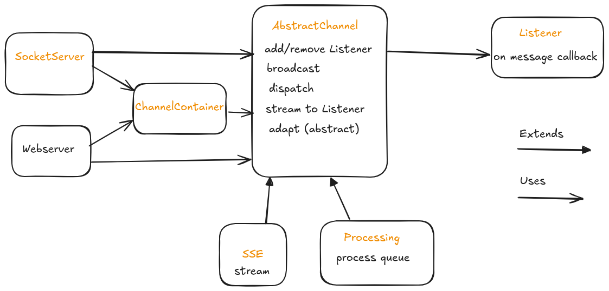

Guide
=====

Eric is a toolkit for async messaging: **channels** deliver **messages** to their subscribers, called
**connections**, and stream them to clients in the channel's output format. The format of the prefabs is the one of
Server Sent Events, so a web server can return a channel's stream as it is.

Everything works in memory out of the box. Persistence, durable queues, error handling and custom channels are
optional parts you add when you need them.

A first example
---------------

The following code creates a channel, subscribes to it, sends a message and streams it.
`Here <https://github.com/laxertu/eric/blob/master/examples/inmemory.py>`_ is the complete example.

.. code-block:: python

    import asyncio

    from eric_sse.message import Message
    from eric_sse.prefabs import SSEChannel

    channel = SSEChannel()
    connection = channel.add_connection()
    channel.dispatch(connection.id, Message(msg_type='welcome', msg_payload='Hello!'))

    async def main():
        async for sse_event in channel.message_stream(connection.id):
            print(f'Received message: {sse_event}')

    if __name__ == '__main__':
        asyncio.run(main())

The model
---------

* A **message** (:class:`~eric_sse.message.MessageContract`) has a type, a payload and an optional id.
  :class:`~eric_sse.message.Message` is the plain one, :class:`~eric_sse.message.SignedMessage` adds a sender.
* A **channel** (:class:`~eric_sse.entities.AbstractChannel`) is where messages are sent: to one connection with
  :meth:`~eric_sse.entities.AbstractChannel.dispatch`, or to all of them with
  :meth:`~eric_sse.entities.AbstractChannel.broadcast`. It decides the output format through
  :meth:`~eric_sse.entities.AbstractChannel.adapt`.
* A **connection** (:class:`~eric_sse.connection.Connection`) is a subscription to a channel: a listener and its own
  queue, with an id. :meth:`~eric_sse.entities.AbstractChannel.add_connection` creates one,
  :meth:`~eric_sse.entities.AbstractChannel.register_listener` creates one around your listener.
* A **listener** (:class:`~eric_sse.listener.MessageQueueListener`) is what the subscriber does with each message, in
  :meth:`~eric_sse.listener.MessageQueueListener.on_message`. It does nothing by default.
* A **queue** (:class:`~eric_sse.queues.Queue`) is where a connection's messages wait until they are consumed.
  :class:`~eric_sse.queues.InMemoryQueue` is the default.

How a message travels
---------------------

::

    dispatch / broadcast ──> before_dispatch hook ──> connection's queue
                                                            │
                     client <── adapt <── on_message <── consumer

1. ``dispatch`` or ``broadcast`` passes the message to the
   :meth:`~eric_sse.entities.AbstractChannel.before_dispatch` hook, that can change it or drop it, then pushes it to
   the queue of each recipient connection. Sending never waits for consumers.
2. A consumer pops the message from the queue, the connection's listener receives it in ``on_message``, and the
   channel adapts it to its output format.

There are three ways to consume a connection's messages:

* :meth:`~eric_sse.entities.AbstractChannel.message_stream`: an async stream, what a web server returns to a client.
  It starts the listener, waits for messages without consuming CPU, and ends when the listener is stopped.
* :meth:`~eric_sse.entities.AbstractChannel.deliver_next` and
  :meth:`~eric_sse.entities.AbstractChannel.wait_next`: one message at a time, synchronous or async, for code that
  pulls messages itself. They require a started listener.
* :meth:`~eric_sse.prefabs.DataProcessingChannel.process_queue`: runs the listener on every queued message in parallel,
  in an executor, see :class:`~eric_sse.prefabs.DataProcessingChannel`.

Prefabs
-------

* :class:`~eric_sse.prefabs.SSEChannel`: Server Sent Events output, the general purpose channel.
* :class:`~eric_sse.prefabs.DataProcessingChannel`: processes queued messages in parallel and streams the results to
  the client that pushed them.
* :class:`~eric_sse.prefabs.SimpleDistributedApplicationChannel`: a mediator between listeners that communicate with
  each other through actions.
* :class:`~eric_sse.servers.SocketServer` and :class:`~eric_sse.clients.SocketClient`: drive channels from other
  processes through a Unix socket.

Making it yours
---------------

Each part has its own extension point, so you only replace what you need:

.. list-table::
   :header-rows: 1

   * - To change
     - Do this
   * - What happens when a message arrives
     - Subclass :class:`~eric_sse.listener.MessageQueueListener` and override ``on_message``
   * - The output format
     - Override :meth:`~eric_sse.entities.AbstractChannel.adapt` and
       :meth:`~eric_sse.entities.AbstractChannel.adapt_error`, or extend
       :class:`~eric_sse.entities.AbstractChannel`
   * - Channel behaviour: subscriptions, streams, filtering, errors
     - Override the channel's hooks, e.g. ``on_connection_added``, ``on_stream_end``, ``before_dispatch``,
       ``on_error``. They do nothing by default
   * - Where messages wait, e.g. a durable backend
     - Implement a :class:`~eric_sse.queues.Queue`: only ``push`` and ``pop(timeout)`` are required
   * - Where channels and connections are stored
     - Implement a :class:`~eric_sse.repository.KvStorage` and give it to a
       :class:`~eric_sse.builder.ChannelRepositoryBuilder`, see :doc:`persistence`
   * - What happens when a queue or a listener fails
     - Register error handlers, or use the Dead Letter and Reliable Queue patterns, see :doc:`error_handling` and
       :doc:`queue_patterns`

Persistence is always explicit: channels and their connections are stored when you call ``persist`` on a repository,
never implicitly. Messages are stored by queues themselves, so sending never needs a ``persist``.

When you write your own storage, queue or channel, check it with the test suites in :doc:`contracts`.

Where to go next
----------------

* :doc:`tutorials`: two complete programs, in memory and persisted with SQLite.
* :doc:`persistence`, :doc:`error_handling`, :doc:`queue_patterns`, :doc:`profiling` and :doc:`contracts`: one topic
  each.
* :doc:`class_reference`: every class, generated from the source code.

Overview
--------

| thanks a lot https://excalidraw.com !!

.. toctree::
   :maxdepth: 2
   :hidden:

   persistence
   error_handling
   queue_patterns
   profiling
   contracts
