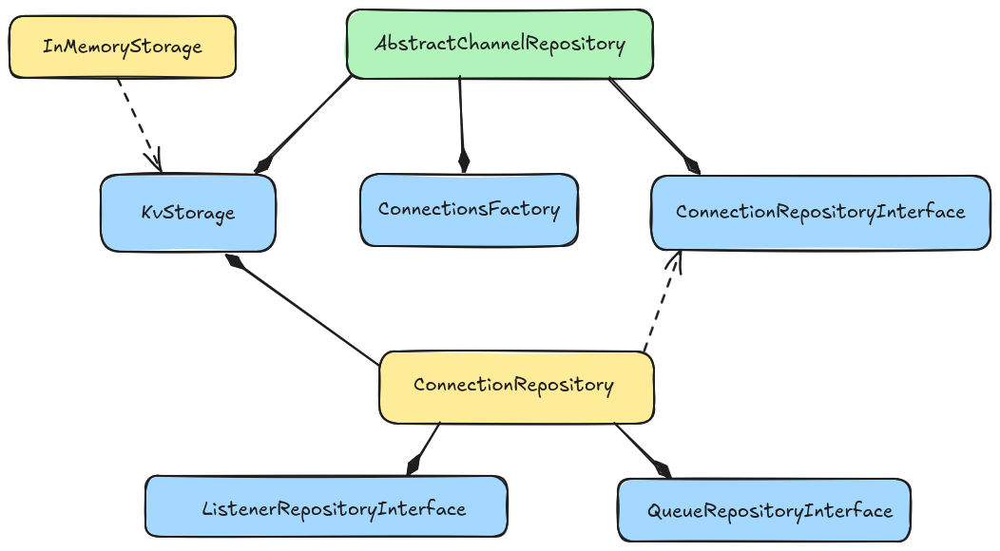

Persistence
===========

Base classes for channels and connections repositories.
The main idea is that a repository relies on some KV storage engine abstraction, and uses it for storing its own configuration, and its correspondant composites repositories to build final objects to return.

To build a persistence layer is needed to provide an implementation to some of above abstractions, and use them to build a custom ChannelRepository

**Suggestions**

If your implementation uses objects that are directly persistable by storage engine you are using, cleanest manner of implementing your custom layer is to simply
give an implementation to a :class:`~eric_sse.repository.KvStorage` and just use it in all composite repositories.
Otherwise you should implement a dump strategy inside repositories themselves, e.g. when queues hold a client connection that can't be serialised by pickle.

Builder
=======
:class:`~eric_sse.builder.ChannelRepositoryBuilder` is the easiest way to get a working persistence layer. By default it
stores everything in one storage instance, each kind of object under its own namespace::

    from eric_sse.builder import ChannelRepositoryBuilder
    from eric_sse.prefabs import SSEChannel

    repository = ChannelRepositoryBuilder(SSEChannel, my_storage).listeners(MyListener).build()

    channel = repository.create({'retry_timeout_milliseconds': 100})
    listener = channel.add_listener()
    repository.persist(channel)

Persistence is always explicit: channels and their connections are stored when you call ``persist``. Messages are
persisted by queues themselves, so ``dispatch`` and ``broadcast`` do not need a ``persist``.

See :doc:`reference/persistence` for the classes.
