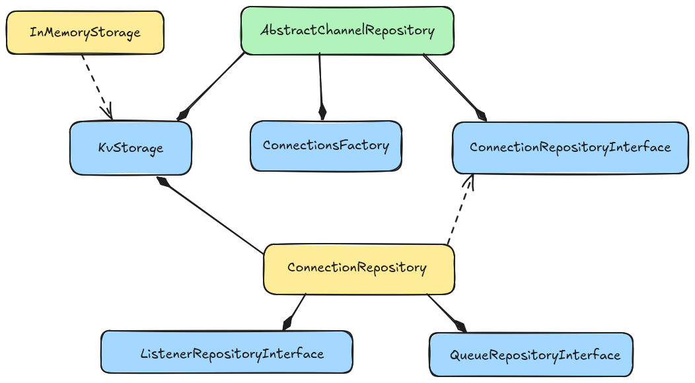

<a id="persistence"></a>

# Persistence



Base classes for channels and connections repositories.
The main idea is that a repository relies on some KV storage engine abstraction, and uses it for storing its own configuration, and its correspondant composites repositories to build final objects to return.

To build a persistence layer is needed to provide an implementation to some of above abstractions, and use them to build a custom ChannelRepository

[Here](https://github.com/laxertu/eric-redis-queues/blob/master/eric_redis_queues/repository.py) is a possible Redis implementation

**Suggestions**

If your implementation uses objects that are directly persistable by storage engine you are using, cleanest manner of implementing your custom layer is to simply
give an implementation to a [`KvStorage`](#eric_sse.repository.KvStorage) and just use it in all composite repositories.
Otherwise you should implement a dump strategy inside repositories themselves. An example is RedisQueues persistence, as Redis client used is not serializable by pickle.

<a id="builder"></a>

# Builder

[`ChannelRepositoryBuilder`](#eric_sse.builder.ChannelRepositoryBuilder) is the easiest way to get a working persistence layer. By default it
stores everything in one storage instance, each kind of object under its own namespace:

```default
from eric_sse.builder import ChannelRepositoryBuilder

repository = ChannelRepositoryBuilder(my_storage).listeners(MyListener).build()

channel = repository.create({'retry_timeout_milliseconds': 100})
listener = channel.add_listener()
repository.persist(channel)
```

Persistence is always explicit: channels and their connections are stored when you call `persist`. Messages are
persisted by queues themselves, so `dispatch` and `broadcast` do not need a `persist`.

<a id="module-eric_sse.builder"></a>

<a id="eric_sse.builder.ChannelRepositoryBuilder"></a>

### *class* ChannelRepositoryBuilder

Wires a channel repository and its connections, listeners and queues repositories.

Every part is stored in **storage** under its own namespace (`channel:`, `connection:`, `listener:`, `queue:`),
unless a dedicated storage or repository is given for it. Each method returns the builder, so calls can be chained:

```default
repository = (
    ChannelRepositoryBuilder(storage)
    .listeners(MyListener)
    .queues_repository(RedisQueuesRepository(redis_connection))
    .build()
)
```

Channels built by the resulting repository create their listeners and queues through it.
Nothing is persisted implicitly: call the repository’s `persist` when needed.

When a part is configured more than once, the last call wins.

* **Parameters:**
  **storage** ([*KvStorage*](#eric_sse.repository.KvStorage)) – Default storage. Defaults to a new [`InMemoryStorage`](#eric_sse.repository.InMemoryStorage).

<a id="eric_sse.builder.ChannelRepositoryBuilder.__init__"></a>

#### \_\_init_\_(storage=None)

* **Parameters:**
  **storage** ([*KvStorage*](#eric_sse.repository.KvStorage) *|* *None*)

<a id="eric_sse.builder.ChannelRepositoryBuilder.channels"></a>

#### channels(channel_class=<class 'eric_sse.prefabs.SSEChannel'>, storage=None)

* **Parameters:**
  * **channel_class** ([*type*](https://docs.python.org/3/builtins/functions.html#type) *[*[*AbstractChannel*](entities.md#eric_sse.entities.AbstractChannel) *]*) – Class of channels the repository creates, loads and persists. Defaults to [`SSEChannel`](prefabs.md#eric_sse.prefabs.SSEChannel).
  * **storage** ([*KvStorage*](#eric_sse.repository.KvStorage) *|* *None*) – Dedicated storage for channels.
* **Return type:**
  [*ChannelRepositoryBuilder*](#eric_sse.builder.ChannelRepositoryBuilder)

<a id="eric_sse.builder.ChannelRepositoryBuilder.connections"></a>

#### connections(storage)

* **Parameters:**
  **storage** ([*KvStorage*](#eric_sse.repository.KvStorage)) – Dedicated storage for connections.
* **Return type:**
  [*ChannelRepositoryBuilder*](#eric_sse.builder.ChannelRepositoryBuilder)

<a id="eric_sse.builder.ChannelRepositoryBuilder.listeners"></a>

#### listeners(listener_class=<class 'eric_sse.listener.MessageQueueListener'>, storage=None)

Uses a [`KvListenerRepository`](#eric_sse.repository.KvListenerRepository).

* **Parameters:**
  * **listener_class** ([*type*](https://docs.python.org/3/builtins/functions.html#type) *[*[*MessageQueueListener*](entities.md#eric_sse.listener.MessageQueueListener) *]*) – Class of listeners created by channels. Defaults to [`MessageQueueListener`](entities.md#eric_sse.listener.MessageQueueListener).
  * **storage** ([*KvStorage*](#eric_sse.repository.KvStorage) *|* *None*) – Dedicated storage for listeners.
* **Return type:**
  [*ChannelRepositoryBuilder*](#eric_sse.builder.ChannelRepositoryBuilder)

<a id="eric_sse.builder.ChannelRepositoryBuilder.listeners_repository"></a>

#### listeners_repository(repository)

Uses a custom listeners repository, that also decides which listeners are created.

* **Parameters:**
  **repository** ([*ListenerRepositoryInterface*](#eric_sse.interfaces.ListenerRepositoryInterface))
* **Return type:**
  [*ChannelRepositoryBuilder*](#eric_sse.builder.ChannelRepositoryBuilder)

<a id="eric_sse.builder.ChannelRepositoryBuilder.queues"></a>

#### queues(queue_factory=<class 'eric_sse.queues.InMemoryQueue'>, storage=None)

Uses a [`KvQueueRepository`](#eric_sse.repository.KvQueueRepository).

* **Parameters:**
  * **queue_factory** ([*Callable*](https://docs.python.org/3/library/typing.html#typing.Callable) *[* *[* *]* *,* [*Queue*](entities.md#eric_sse.queues.Queue) *]*) – Called once per connection to create its queue. Defaults to [`InMemoryQueue`](entities.md#eric_sse.queues.InMemoryQueue).
  * **storage** ([*KvStorage*](#eric_sse.repository.KvStorage) *|* *None*) – Dedicated storage for queues.
* **Return type:**
  [*ChannelRepositoryBuilder*](#eric_sse.builder.ChannelRepositoryBuilder)

<a id="eric_sse.builder.ChannelRepositoryBuilder.queues_repository"></a>

#### queues_repository(repository)

Uses a custom queues repository, that also decides which queues are created.

* **Parameters:**
  **repository** ([*QueueRepositoryInterface*](#eric_sse.interfaces.QueueRepositoryInterface))
* **Return type:**
  [*ChannelRepositoryBuilder*](#eric_sse.builder.ChannelRepositoryBuilder)

<a id="eric_sse.builder.ChannelRepositoryBuilder.build"></a>

#### build()

Returns a new channel repository. The builder can be reused.

* **Return type:**
  [*ChannelRepository*](#eric_sse.repository.ChannelRepository)

<a id="module-eric_sse.repository"></a>

<a id="base-repositories"></a>

# Base repositories

<a id="eric_sse.repository.KvStorage"></a>

### *class* KvStorage

Bases: [`ABC`](https://docs.python.org/3/library/abc.html#abc.ABC), [`Generic`](https://docs.python.org/3/library/typing.html#typing.Generic)[`T`]

Represents a Key Value storage engine. Provides functionalities do load, persist and find by key prefix

<a id="eric_sse.repository.KvStorage.fetch_by_prefix"></a>

#### *abstract* fetch_by_prefix(prefix)

Search by KV prefix

Implementations must tolerate deletions of fetched keys while the result is being iterated.

* **Parameters:**
  **prefix** ([*str*](https://docs.python.org/3/builtins/stdtypes.html#str))
* **Return type:**
  [*Iterable*](https://docs.python.org/3/library/typing.html#typing.Iterable)[*T*]

<a id="eric_sse.repository.KvStorage.fetch_all"></a>

#### *abstract* fetch_all()

Return all items that have been persisted

Implementations must tolerate deletions of fetched keys while the result is being iterated.

* **Return type:**
  [*Iterable*](https://docs.python.org/3/library/typing.html#typing.Iterable)[*T*]

<a id="eric_sse.repository.KvStorage.upsert"></a>

#### *abstract* upsert(key, value)

Updates or inserts a value given its corresponding key

* **Parameters:**
  * **key** ([*str*](https://docs.python.org/3/builtins/stdtypes.html#str))
  * **value** (*T*)

<a id="eric_sse.repository.KvStorage.fetch_one"></a>

#### *abstract* fetch_one(key)

Return value correspondant to key

* **Parameters:**
  **key** ([*str*](https://docs.python.org/3/builtins/stdtypes.html#str))
* **Return type:**
  *T*

<a id="eric_sse.repository.KvStorage.delete"></a>

#### *abstract* delete(key)

Idempotent deletion. Do not throw an error on invalid key

* **Parameters:**
  **key** ([*str*](https://docs.python.org/3/builtins/stdtypes.html#str))

<a id="eric_sse.repository.InMemoryStorage"></a>

### *class* InMemoryStorage

Bases: [`KvStorage`](#eric_sse.repository.KvStorage)[`T`]

In memory implementation

<a id="eric_sse.repository.InMemoryStorage.__init__"></a>

#### \_\_init_\_(items=None)

* **Parameters:**
  **items** ([*dict*](https://docs.python.org/3/builtins/stdtypes.html#dict) *[*[*str*](https://docs.python.org/3/builtins/stdtypes.html#str) *,* *T* *]*  *|* *None*)

<a id="eric_sse.repository.InMemoryStorage.fetch_by_prefix"></a>

#### fetch_by_prefix(prefix)

Search by KV prefix

Implementations must tolerate deletions of fetched keys while the result is being iterated.

* **Parameters:**
  **prefix** ([*str*](https://docs.python.org/3/builtins/stdtypes.html#str))
* **Return type:**
  [*Iterable*](https://docs.python.org/3/library/typing.html#typing.Iterable)[*T*]

<a id="eric_sse.repository.InMemoryStorage.fetch_all"></a>

#### fetch_all()

Return all items that have been persisted

Implementations must tolerate deletions of fetched keys while the result is being iterated.

* **Return type:**
  [*Iterable*](https://docs.python.org/3/library/typing.html#typing.Iterable)[*T*]

<a id="eric_sse.repository.InMemoryStorage.upsert"></a>

#### upsert(key, value)

Updates or inserts a value given its corresponding key

* **Parameters:**
  * **key** ([*str*](https://docs.python.org/3/builtins/stdtypes.html#str))
  * **value** (*T*)

<a id="eric_sse.repository.InMemoryStorage.fetch_one"></a>

#### fetch_one(key)

Return value correspondant to key

* **Parameters:**
  **key** ([*str*](https://docs.python.org/3/builtins/stdtypes.html#str))
* **Return type:**
  *T*

<a id="eric_sse.repository.InMemoryStorage.delete"></a>

#### delete(key)

Idempotent deletion. Do not throw an error on invalid key

* **Parameters:**
  **key** ([*str*](https://docs.python.org/3/builtins/stdtypes.html#str))

<a id="eric_sse.repository.PrefixedStorage"></a>

### *class* PrefixedStorage

Bases: [`KvStorage`](#eric_sse.repository.KvStorage)[`T`]

A namespaced view of another [`KvStorage`](#eric_sse.repository.KvStorage). All keys are prefixed with **prefix**.

Allows several repositories to share a single storage instance.
Prefixes of storages sharing the same instance must not be prefixes of each other.

<a id="eric_sse.repository.PrefixedStorage.__init__"></a>

#### \_\_init_\_(storage, prefix)

* **Parameters:**
  * **storage** ([*KvStorage*](#eric_sse.repository.KvStorage))
  * **prefix** ([*str*](https://docs.python.org/3/builtins/stdtypes.html#str))

<a id="eric_sse.repository.PrefixedStorage.fetch_by_prefix"></a>

#### fetch_by_prefix(prefix)

Search by KV prefix

Implementations must tolerate deletions of fetched keys while the result is being iterated.

* **Parameters:**
  **prefix** ([*str*](https://docs.python.org/3/builtins/stdtypes.html#str))
* **Return type:**
  [*Iterable*](https://docs.python.org/3/library/typing.html#typing.Iterable)[*T*]

<a id="eric_sse.repository.PrefixedStorage.fetch_all"></a>

#### fetch_all()

Return all items that have been persisted

Implementations must tolerate deletions of fetched keys while the result is being iterated.

* **Return type:**
  [*Iterable*](https://docs.python.org/3/library/typing.html#typing.Iterable)[*T*]

<a id="eric_sse.repository.PrefixedStorage.upsert"></a>

#### upsert(key, value)

Updates or inserts a value given its corresponding key

* **Parameters:**
  * **key** ([*str*](https://docs.python.org/3/builtins/stdtypes.html#str))
  * **value** (*T*)

<a id="eric_sse.repository.PrefixedStorage.fetch_one"></a>

#### fetch_one(key)

Return value correspondant to key

* **Parameters:**
  **key** ([*str*](https://docs.python.org/3/builtins/stdtypes.html#str))
* **Return type:**
  *T*

<a id="eric_sse.repository.PrefixedStorage.delete"></a>

#### delete(key)

Idempotent deletion. Do not throw an error on invalid key

* **Parameters:**
  **key** ([*str*](https://docs.python.org/3/builtins/stdtypes.html#str))

<a id="eric_sse.repository.KvListenerRepository"></a>

### *class* KvListenerRepository

Bases: [`ListenerRepositoryInterface`](#eric_sse.interfaces.ListenerRepositoryInterface), [`Generic`](https://docs.python.org/3/library/typing.html#typing.Generic)[`L`]

Listener repository backed by a [`KvStorage`](#eric_sse.repository.KvStorage).

Listeners are stored as they are, keyed by connection id; serialization, if needed, is up to the storage.

* **Parameters:**
  * **storage**
  * **listener_class** – Class of listeners created by [`create()`](#eric_sse.repository.KvListenerRepository.create). Defaults to [`MessageQueueListener`](entities.md#eric_sse.listener.MessageQueueListener).

<a id="eric_sse.repository.KvListenerRepository.__init__"></a>

#### \_\_init_\_(storage, listener_class=<class 'eric_sse.listener.MessageQueueListener'>)

* **Parameters:**
  * **storage** ([*KvStorage*](#eric_sse.repository.KvStorage) *[**L* *]*)
  * **listener_class** ([*type*](https://docs.python.org/3/builtins/functions.html#type) *[**L* *]*)

<a id="eric_sse.repository.KvListenerRepository.create"></a>

#### create()

Creates a new listener. It is not persisted.

* **Return type:**
  *L*

<a id="eric_sse.repository.KvListenerRepository.load"></a>

#### load(connection_id)

Loads a listener given the connection id it belongs to.

* **Parameters:**
  **connection_id** ([*str*](https://docs.python.org/3/builtins/stdtypes.html#str))
* **Return type:**
  *L*

<a id="eric_sse.repository.KvListenerRepository.persist"></a>

#### persist(connection_id, listener)

Persists listener and assign to connection.

* **Parameters:**
  * **connection_id** ([*str*](https://docs.python.org/3/builtins/stdtypes.html#str))
  * **listener** (*L*)

<a id="eric_sse.repository.KvListenerRepository.delete"></a>

#### delete(connection_id)

Deleted a listener given the connection id it belongs to.

* **Parameters:**
  **connection_id** ([*str*](https://docs.python.org/3/builtins/stdtypes.html#str))

<a id="eric_sse.repository.KvQueueRepository"></a>

### *class* KvQueueRepository

Bases: [`QueueRepositoryInterface`](#eric_sse.interfaces.QueueRepositoryInterface), [`Generic`](https://docs.python.org/3/library/typing.html#typing.Generic)[`Q`]

Queue repository backed by a [`KvStorage`](#eric_sse.repository.KvStorage).

Queues are stored as they are, keyed by connection id; serialization, if needed, is up to the storage.

Each queue class decides what of its state is serialised. A durable queue keeps its messages in its own
backend and serialises only its identity and configuration (e.g. through `__getstate__`), because
messages are written by the queue itself on every push and pop.
[`InMemoryQueue`](entities.md#eric_sse.queues.InMemoryQueue) can’t be serialised: use it with a storage that keeps objects in process,
such as [`InMemoryStorage`](#eric_sse.repository.InMemoryStorage).

* **Parameters:**
  * **storage**
  * **queue_factory** – Called by [`create()`](#eric_sse.repository.KvQueueRepository.create) to create a queue. Defaults to [`InMemoryQueue`](entities.md#eric_sse.queues.InMemoryQueue).

<a id="eric_sse.repository.KvQueueRepository.__init__"></a>

#### \_\_init_\_(storage, queue_factory=<class 'eric_sse.queues.InMemoryQueue'>)

* **Parameters:**
  * **storage** ([*KvStorage*](#eric_sse.repository.KvStorage) *[**Q* *]*)
  * **queue_factory** ([*Callable*](https://docs.python.org/3/library/typing.html#typing.Callable) *[* *[* *]* *,* *Q* *]*)

<a id="eric_sse.repository.KvQueueRepository.create"></a>

#### create()

Creates a new queue. It is not persisted.

* **Return type:**
  *Q*

<a id="eric_sse.repository.KvQueueRepository.load"></a>

#### load(connection_id)

Loads a queue given the connection id it belongs to.

* **Parameters:**
  **connection_id** ([*str*](https://docs.python.org/3/builtins/stdtypes.html#str))
* **Return type:**
  *Q*

<a id="eric_sse.repository.KvQueueRepository.persist"></a>

#### persist(connection_id, queue)

Persists queue and assign to connection.

* **Parameters:**
  * **connection_id** ([*str*](https://docs.python.org/3/builtins/stdtypes.html#str))
  * **queue** (*Q*)

<a id="eric_sse.repository.KvQueueRepository.delete"></a>

#### delete(connection_id)

Deletes a queue given the connection id it belongs to.

* **Parameters:**
  **connection_id** ([*str*](https://docs.python.org/3/builtins/stdtypes.html#str))

<a id="eric_sse.repository.ChannelRepository"></a>

### *class* ChannelRepository

Bases: [`ChannelRepositoryInterface`](#eric_sse.interfaces.ChannelRepositoryInterface)

Persists channels of a given class, using their [`to_dict()`](entities.md#eric_sse.entities.AbstractChannel.to_dict) and
[`from_dict()`](entities.md#eric_sse.entities.AbstractChannel.from_dict) methods.

Channels it builds get [`connections_repository`](#eric_sse.repository.ChannelRepository.connections_repository) as **connections_factory**,
so that new connections are created by the persistence layer.

* **Parameters:**
  * **storage** – Storage for channels configuration.
  * **connections_repository**
  * **channel_class** – Class of channels this repository creates, loads and persists, e.g. [`SSEChannel`](prefabs.md#eric_sse.prefabs.SSEChannel).

<a id="eric_sse.repository.ChannelRepository.__init__"></a>

#### \_\_init_\_(storage, connections_repository, channel_class)

* **Parameters:**
  * **storage** ([*KvStorage*](#eric_sse.repository.KvStorage))
  * **connections_repository** ([*ConnectionRepositoryInterface*](#eric_sse.interfaces.ConnectionRepositoryInterface))
  * **channel_class** ([*type*](https://docs.python.org/3/builtins/functions.html#type) *[*[*AbstractChannel*](entities.md#eric_sse.entities.AbstractChannel) *]*)

<a id="eric_sse.repository.ChannelRepository.connections_repository"></a>

#### *property* connections_repository *: [ConnectionRepositoryInterface](#eric_sse.interfaces.ConnectionRepositoryInterface)*

Repository to be used to persist connections. It is also the connections factory injected into the channels it builds.

<a id="eric_sse.repository.ChannelRepository.create"></a>

#### create(channel_data)

Creates a channel. It is not persisted.

* **Parameters:**
  **channel_data** ([*dict*](https://docs.python.org/3/builtins/stdtypes.html#dict)) – Constructor parameters of **channel_class**, except **connections_factory**.
* **Return type:**
  [*AbstractChannel*](entities.md#eric_sse.entities.AbstractChannel)

<a id="eric_sse.repository.ChannelRepository.load_all"></a>

#### load_all()

Loads all channels

* **Return type:**
  [*Iterable*](https://docs.python.org/3/library/typing.html#typing.Iterable)[[*AbstractChannel*](entities.md#eric_sse.entities.AbstractChannel)]

<a id="eric_sse.repository.ChannelRepository.load_one"></a>

#### load_one(channel_id)

Loads a channel given its it

* **Parameters:**
  **channel_id** ([*str*](https://docs.python.org/3/builtins/stdtypes.html#str))
* **Return type:**
  [*AbstractChannel*](entities.md#eric_sse.entities.AbstractChannel)

<a id="eric_sse.repository.ChannelRepository.persist"></a>

#### persist(channel)

Persists channel configuration and its connections. Raises a TypeError if channel is not exactly of **channel_class**.

* **Parameters:**
  **channel** ([*AbstractChannel*](entities.md#eric_sse.entities.AbstractChannel))

<a id="eric_sse.repository.ChannelRepository.delete"></a>

#### delete(channel_id)

Deletes channel configuration and its connections. Idempotent.

* **Parameters:**
  **channel_id** ([*str*](https://docs.python.org/3/builtins/stdtypes.html#str))

<a id="eric_sse.repository.ConnectionRepository"></a>

### *class* ConnectionRepository

Bases: [`ConnectionRepositoryInterface`](#eric_sse.interfaces.ConnectionRepositoryInterface)

Concrete Connection Repository

Relies on [`KvStorage`](#eric_sse.repository.KvStorage) abstraction for final writes of connections data, and on
correspondant repositories for related objects ones.

<a id="eric_sse.repository.ConnectionRepository.__init__"></a>

#### \_\_init_\_(storage, listeners_repository, queues_repository)

* **Parameters:**
  * **storage** ([*KvStorage*](#eric_sse.repository.KvStorage))
  * **listeners_repository** ([*ListenerRepositoryInterface*](#eric_sse.interfaces.ListenerRepositoryInterface))
  * **queues_repository** ([*QueueRepositoryInterface*](#eric_sse.interfaces.QueueRepositoryInterface))

<a id="eric_sse.repository.ConnectionRepository.create"></a>

#### create(listener=None)

Creates a connection. Listener, if not provided, and queue are created by the corresponding repositories.

* **Parameters:**
  **listener** ([*MessageQueueListener*](entities.md#eric_sse.listener.MessageQueueListener) *|* *None*)
* **Return type:**
  [*Connection*](entities.md#eric_sse.connection.Connection)

<a id="eric_sse.repository.ConnectionRepository.load_ids"></a>

#### load_ids(channel_id)

Ids of the connections managed by a given channel, without loading their listeners and queues.

* **Parameters:**
  **channel_id** ([*str*](https://docs.python.org/3/builtins/stdtypes.html#str))
* **Return type:**
  [*Iterable*](https://docs.python.org/3/library/typing.html#typing.Iterable)[[str](https://docs.python.org/3/builtins/stdtypes.html#str)]

<a id="eric_sse.repository.ConnectionRepository.load_all"></a>

#### load_all(channel_id)

Loads all connections managed by a given channel

* **Parameters:**
  **channel_id** ([*str*](https://docs.python.org/3/builtins/stdtypes.html#str))
* **Return type:**
  [*Iterable*](https://docs.python.org/3/library/typing.html#typing.Iterable)[[*Connection*](entities.md#eric_sse.connection.Connection)]

<a id="eric_sse.repository.ConnectionRepository.load_one"></a>

#### load_one(channel_id, connection_id)

Loads a connection given the connection and channel id it belongs to.

* **Parameters:**
  * **channel_id** ([*str*](https://docs.python.org/3/builtins/stdtypes.html#str))
  * **connection_id** ([*str*](https://docs.python.org/3/builtins/stdtypes.html#str))
* **Return type:**
  [*Connection*](entities.md#eric_sse.connection.Connection)

<a id="eric_sse.repository.ConnectionRepository.persist"></a>

#### persist(channel_id, connection)

Persists a connection and assign it to a channel.

* **Parameters:**
  * **channel_id** ([*str*](https://docs.python.org/3/builtins/stdtypes.html#str))
  * **connection** ([*Connection*](entities.md#eric_sse.connection.Connection))

<a id="eric_sse.repository.ConnectionRepository.delete"></a>

#### delete(channel_id, connection_id)

Deletes a connection given the connection and channel id it belongs to.

* **Parameters:**
  * **channel_id** ([*str*](https://docs.python.org/3/builtins/stdtypes.html#str))
  * **connection_id** ([*str*](https://docs.python.org/3/builtins/stdtypes.html#str))

<a id="module-eric_sse.interfaces"></a>

<a id="interoperability"></a>

# Interoperability

<a id="eric_sse.interfaces.QueueRepositoryInterface"></a>

### *class* QueueRepositoryInterface

Bases: [`ABC`](https://docs.python.org/3/library/abc.html#abc.ABC)

<a id="eric_sse.interfaces.QueueRepositoryInterface.create"></a>

#### *abstract* create()

Creates a new queue. It is not persisted.

* **Return type:**
  [*Queue*](entities.md#eric_sse.queues.Queue)

<a id="eric_sse.interfaces.QueueRepositoryInterface.load"></a>

#### *abstract* load(connection_id)

Loads a queue given the connection id it belongs to.

* **Parameters:**
  **connection_id** ([*str*](https://docs.python.org/3/builtins/stdtypes.html#str))
* **Return type:**
  [*Queue*](entities.md#eric_sse.queues.Queue)

<a id="eric_sse.interfaces.QueueRepositoryInterface.persist"></a>

#### *abstract* persist(connection_id, queue)

Persists queue and assign to connection.

* **Parameters:**
  * **connection_id** ([*str*](https://docs.python.org/3/builtins/stdtypes.html#str))
  * **queue** ([*Queue*](entities.md#eric_sse.queues.Queue))

<a id="eric_sse.interfaces.QueueRepositoryInterface.delete"></a>

#### *abstract* delete(connection_id)

Deletes a queue given the connection id it belongs to.

* **Parameters:**
  **connection_id** ([*str*](https://docs.python.org/3/builtins/stdtypes.html#str))

<a id="eric_sse.interfaces.ListenerRepositoryInterface"></a>

### *class* ListenerRepositoryInterface

Bases: [`ABC`](https://docs.python.org/3/library/abc.html#abc.ABC)

<a id="eric_sse.interfaces.ListenerRepositoryInterface.create"></a>

#### *abstract* create()

Creates a new listener. It is not persisted.

* **Return type:**
  [*MessageQueueListener*](entities.md#eric_sse.listener.MessageQueueListener)

<a id="eric_sse.interfaces.ListenerRepositoryInterface.load"></a>

#### *abstract* load(connection_id)

Loads a listener given the connection id it belongs to.

* **Parameters:**
  **connection_id** ([*str*](https://docs.python.org/3/builtins/stdtypes.html#str))
* **Return type:**
  [*MessageQueueListener*](entities.md#eric_sse.listener.MessageQueueListener)

<a id="eric_sse.interfaces.ListenerRepositoryInterface.persist"></a>

#### *abstract* persist(connection_id, listener)

Persists listener and assign to connection.

* **Parameters:**
  * **connection_id** ([*str*](https://docs.python.org/3/builtins/stdtypes.html#str))
  * **listener** ([*MessageQueueListener*](entities.md#eric_sse.listener.MessageQueueListener))

<a id="eric_sse.interfaces.ListenerRepositoryInterface.delete"></a>

#### *abstract* delete(connection_id)

Deleted a listener given the connection id it belongs to.

* **Parameters:**
  **connection_id** ([*str*](https://docs.python.org/3/builtins/stdtypes.html#str))

<a id="eric_sse.interfaces.ConnectionRepositoryInterface"></a>

### *class* ConnectionRepositoryInterface

Bases: [`ConnectionsFactory`](entities.md#eric_sse.connection.ConnectionsFactory), [`ABC`](https://docs.python.org/3/library/abc.html#abc.ABC)

Persists connections, and creates them using its listeners and queues repositories.

Channel repositories inject it as **connections_factory** into the channels they build.

<a id="eric_sse.interfaces.ConnectionRepositoryInterface.queues_repository"></a>

#### *abstract property* queues_repository *: [QueueRepositoryInterface](#eric_sse.interfaces.QueueRepositoryInterface)*

<a id="eric_sse.interfaces.ConnectionRepositoryInterface.listeners_repository"></a>

#### *abstract property* listeners_repository *: [ListenerRepositoryInterface](#eric_sse.interfaces.ListenerRepositoryInterface)*

<a id="eric_sse.interfaces.ConnectionRepositoryInterface.load_ids"></a>

#### *abstract* load_ids(channel_id)

Ids of the connections managed by a given channel, without loading their listeners and queues.

* **Parameters:**
  **channel_id** ([*str*](https://docs.python.org/3/builtins/stdtypes.html#str))
* **Return type:**
  [*Iterable*](https://docs.python.org/3/library/typing.html#typing.Iterable)[[str](https://docs.python.org/3/builtins/stdtypes.html#str)]

<a id="eric_sse.interfaces.ConnectionRepositoryInterface.load_all"></a>

#### *abstract* load_all(channel_id)

Loads all connections managed by a given channel

* **Parameters:**
  **channel_id** ([*str*](https://docs.python.org/3/builtins/stdtypes.html#str))
* **Return type:**
  [*Iterable*](https://docs.python.org/3/library/typing.html#typing.Iterable)[[*Connection*](entities.md#eric_sse.connection.Connection)]

<a id="eric_sse.interfaces.ConnectionRepositoryInterface.load_one"></a>

#### *abstract* load_one(channel_id, connection_id)

Loads a connection given the connection and channel id it belongs to.

* **Parameters:**
  * **channel_id** ([*str*](https://docs.python.org/3/builtins/stdtypes.html#str))
  * **connection_id** ([*str*](https://docs.python.org/3/builtins/stdtypes.html#str))
* **Return type:**
  [*Connection*](entities.md#eric_sse.connection.Connection)

<a id="eric_sse.interfaces.ConnectionRepositoryInterface.persist"></a>

#### *abstract* persist(channel_id, connection)

Persists a connection and assign it to a channel.

* **Parameters:**
  * **channel_id** ([*str*](https://docs.python.org/3/builtins/stdtypes.html#str))
  * **connection** ([*Connection*](entities.md#eric_sse.connection.Connection))

<a id="eric_sse.interfaces.ConnectionRepositoryInterface.delete"></a>

#### *abstract* delete(channel_id, connection_id)

Deletes a connection given the connection and channel id it belongs to.

* **Parameters:**
  * **channel_id** ([*str*](https://docs.python.org/3/builtins/stdtypes.html#str))
  * **connection_id** ([*str*](https://docs.python.org/3/builtins/stdtypes.html#str))

<a id="eric_sse.interfaces.ChannelRepositoryInterface"></a>

### *class* ChannelRepositoryInterface

Bases: [`ABC`](https://docs.python.org/3/library/abc.html#abc.ABC)

<a id="eric_sse.interfaces.ChannelRepositoryInterface.connections_repository"></a>

#### *abstract property* connections_repository *: [ConnectionRepositoryInterface](#eric_sse.interfaces.ConnectionRepositoryInterface)*

Repository to be used to persist connections. It is also the connections factory injected into the channels it builds.

<a id="eric_sse.interfaces.ChannelRepositoryInterface.load_all"></a>

#### *abstract* load_all()

Loads all channels

* **Return type:**
  [*Iterable*](https://docs.python.org/3/library/typing.html#typing.Iterable)[[*AbstractChannel*](entities.md#eric_sse.entities.AbstractChannel)]

<a id="eric_sse.interfaces.ChannelRepositoryInterface.load_one"></a>

#### *abstract* load_one(channel_id)

Loads a channel given its it

* **Parameters:**
  **channel_id** ([*str*](https://docs.python.org/3/builtins/stdtypes.html#str))
* **Return type:**
  [*AbstractChannel*](entities.md#eric_sse.entities.AbstractChannel)

<a id="eric_sse.interfaces.ChannelRepositoryInterface.persist"></a>

#### *abstract* persist(channel)

Persists a channel

* **Parameters:**
  **channel** ([*AbstractChannel*](entities.md#eric_sse.entities.AbstractChannel))

<a id="eric_sse.interfaces.ChannelRepositoryInterface.delete"></a>

#### *abstract* delete(channel_id)

Deletes a channel given its it

* **Parameters:**
  **channel_id** ([*str*](https://docs.python.org/3/builtins/stdtypes.html#str))

<a id="eric_sse.interfaces.ChannelRepositoryInterface.create"></a>

#### *abstract* create(channel_data)

Creates a new channel and configures it depending on channel_data.

* **Parameters:**
  **channel_data** ([*dict*](https://docs.python.org/3/builtins/stdtypes.html#dict))
* **Return type:**
  [*AbstractChannel*](entities.md#eric_sse.entities.AbstractChannel)
